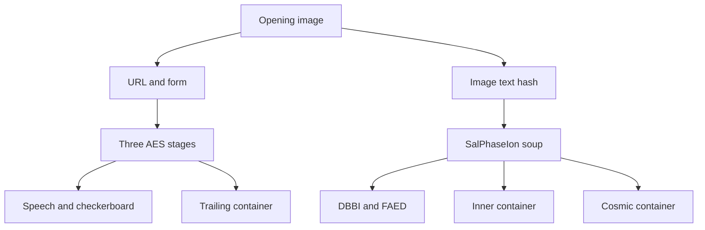
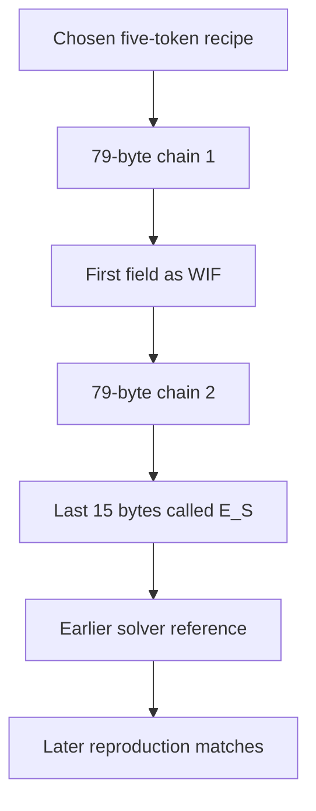

> **Archive header (added 2026-10-15 by the GSMG consolidation build).** This is the prior deliverable, prepared 14 October 2026, reproduced verbatim below this header. SHA-256 of the original file without this header: `e6de6b475defa3e3eb27f43f14d7b4a97e1980c6b9834322ab4c7d3927477e06`. Links inside it point to files of the original deliverable that were not supplied with it (see DECISIONS.md).

---

# GSMG — repository evidence and structured reasoning report

Prepared 14 October 2026. Starting directory: `/workspace/scratch/3daf1a8f949c`.

**Research boundary:** this report starts from the operator's supplied brief and newly acquired public sources. No earlier conversation, remembered puzzle result, previous research workspace, or Personal Context search was used. The brief's instruction to reconcile held research was superseded by the operator's explicit request to avoid that material. Pointers such as E054 are recorded as missing inputs, not inherited findings.

This is an evidence report and a reproducible collection, not a solution announcement. Mechanical reproduction and evidence of an intended solution are separate throughout. Collection gaps remain, so it is **not an unqualified certificate of comprehensive historical coverage**.

## Contents

1. [Executive assessment](#1-executive-assessment)
2. [Sources and completeness](#2-sources-and-completeness)
3. [Solved chain](#3-solved-chain)
4. [Unresolved artifacts](#4-unresolved-artifacts)
5. [Creator clues](#5-creator-clues)
6. [Community mechanisms and lineage](#6-community-mechanisms-and-lineage)
7. [Prior experiment coverage](#7-prior-experiment-coverage)
8. [Contradictions and corrections](#8-contradictions-and-corrections)
9. [Structured reasoning assessments](#9-structured-reasoning-assessments)
10. [Naddiseo issue 17](#10-naddiseo-issue-17)
11. [Seed, interval and vanity](#11-seed-interval-and-vanity)
12. [Next checks and stop conditions](#12-next-checks-and-stop-conditions)
13. [Validation and reproduction](#13-validation-and-reproduction)

## 1. Executive assessment

The three principal AES stages reproduce with explicit SHA-256 password hashing and SHA-256 EVP derivation. Their resulting texts, the EBCDIC-to-Beaufort speech, the checkerboard sentence, the opening image URL, the SalPhaseIon entry hash and its four decoded tokens provide a solid mechanical reference. This task verified the grid against the image, recovered the audio spectrogram, checked the 2023 binary transcription against its screenshot, and validated the published uncompressed prize public key against the address. Exact inputs, outputs and hashes are in [ARTIFACT_REGISTRY.csv](ARTIFACT_REGISTRY.csv) and [the result records](records/reproduction_results.json).

The unresolved frontier consists of DBBI, FAED, the Bifid-derived material and several distinct encrypted containers. There is no verified final scalar or independently validated endgame plaintext in this collection. Some community constructions are reproducible without being established puzzle solutions.

The most consequential result concerns **Naddiseo#17**. Its proposed two-link chain reproduces exactly: a raw five-token concatenation opens `salph_inner` under EVP-MD5 to 79 bytes; the uncompressed WIF of the first 32 bytes opens `p32_trailing` under EVP-MD5 to the exact 79 bytes reported in the issue. Python and OpenSSL independently agree. Naddiseo's objection is therefore strongest as an objection to **validation and provenance**, not as a demonstration that those bytes cannot be reproduced. The alleged verification field `E_S` is already present in a solver's January 2026 PR comment. No independently published creator checkpoint for it was found.

Two related distinctions matter. First, Naddiseo's readable-English expectation is explicitly his inference, not a creator instruction established by issue #17. Second, floflo777's later conclusion that the Cosmic construction is definitively a padding accident goes beyond the reproduction and random-padding comparison alone. The construction is compatible with an accidental result, but that experiment does not prove which historical process produced the selected password. The correct finding is **mechanics reproduced; intended significance unverified**.

The full-period Bifid result begins `BTCSEED`, but its alternating restricted alphabet, single `Z`, and equality to a period-2 decode of interleaved input halves are substantially explained by the transformation. The prefix remains an observation worth documenting; it does not define a generator, a scalar, or a small search interval.

The principal information gaps are authentic raw creator-message provenance, unavailable private experiment generators/registers, historical comment edit wording, several inaccessible attachment URLs, and the discovery/selection history of the disputed endgame recipes. Filling those gaps is more useful than expanding an undefined cipher search.

## 2. Sources and completeness

### 2.1 Frozen repository identities

All four requested repositories resolved to the requested identities. None was silently substituted. Git clones were acquired read-only as research sources; downloaded code was not treated as an instruction to execute itself. The API collection ran from 22:15:47 to 22:18:07 UTC on 14 October 2026. Full request logs retain each collection timestamp, page, resolved URL and pagination header.

| Repository | Default branch | Frozen commit | Working-tree files | Advertised branches / tags |
|---|---|---|---:|---:|
| [puzzlehunt/gsmgio-5btc-puzzle](https://github.com/puzzlehunt/gsmgio-5btc-puzzle) | master | `fb92dd15487c6e2d275adb8c923698b7166c328e` | 7 | 1 / 0 |
| [Naddiseo/gsmgio-5btc-puzzle](https://github.com/Naddiseo/gsmgio-5btc-puzzle) | master | `9e61693404ef74e8e681598116d371924f399ffa` | 89 | 1 / 0 |
| [floflo777/open-crypto-puzzles](https://github.com/floflo777/open-crypto-puzzles) | main | `981e7e9bcb696bd7b68340b0f9239545c582afdb` | 473 | 2 / 0 |
| [HosterjackAGV/gsmg-5btc-puzzle](https://github.com/HosterjackAGV/gsmg-5btc-puzzle) | main | `caaa77a8c218e97f9fdaae8908d580e51118edec` | 160 | 3 / 0 |

The entire floflo777 repository was inventoried. Analytical attention was restricted to its GSMG subtree and relevant shared tools, configuration and documentation. Unrelated puzzles were not investigated.

The supplementary PR#68 head was separately fetched at `27ea50eb0544baa6b99f145e9ea51c110010abf4`, from the public pull-request reference. This is **not** the puzzlehunt default-branch snapshot. Its added `GAP_ANALYSIS.md`, patch and history are preserved separately. A referenced `jackdevs66/GSMG5_CDuality` clone failed with HTTP 403; its public README was accessible through web retrieval, so its current public claims were reviewed, but a complete commit-pinned clone was not obtained.

### 2.2 Discussion collection ledger

Issue collection included open and closed records, with pull requests separated below. Repository-wide issue-comment endpoints were paginated to their final page. Each PR's review records were fetched; review comments were fetched separately.

| Repository | Issues excluding PRs | PRs | Issue-list pages | Comment pages | Expected issue comments | Fetched issue comments | Review records | Review comments |
|---|---:|---:|---:|---:|---:|---:|---:|---:|
| puzzlehunt | 102 | 9 | 2 | 7 | 606 | 605 | 3 | 0 |
| Naddiseo | 10 | 7 | 1 | 1 | 36 | 35 | 1 | 1 |
| floflo777 | 26 | 12 | 1 | 1 | 93 | 92 | 1 | 0 |
| HosterjackAGV | 3 | 1 | 1 | 1 | 2 | 2 | 0 | 0 |
| **Total** | **141** | **29** | **5** | **10** | **737** | **734** | **5** | **1** |

The three count mismatches were isolated and their per-issue comment endpoints fetched again:

| Record | Counter | Accessible comments on both fetches | Finding |
|---|---:|---:|---|
| puzzlehunt#25 | 19 | 18 | one counter-indicated comment not returned |
| Naddiseo#2 | 2 | 1 | one counter-indicated comment not returned |
| floflo777#32 | 3 | 2 | one counter-indicated comment not returned; unrelated puzzle |

The reason is not established. A stale counter, deletion, hidden comment or access difference could explain it. These are explicit gaps, not invented fetched records. Naddiseo#17's two accessible comments agree with its counter and both were read completely. Current created/updated timestamps do not reveal a comment's previous wording.

### 2.3 File, attachment and history coverage

The 729 current working-tree files have byte lengths and SHA-256 hashes in [SOURCE_INVENTORY.csv](SOURCE_INVENTORY.csv). The text corpus contains 926 selected file/publication records. There are 1,055 source-to-link occurrences covering 786 distinct URLs. Seventy distinct attachment URLs were attempted: 67 were fetched and three returned 404. Some inaccessible signed URLs may duplicate an image held through another stable URL; inaccessible URLs remain recorded rather than silently replaced. Notebook attachments were extracted separately. Raster assets were machine-extracted by OCR and entered in [ASSET_INSPECTION.csv](appendices/ASSET_INSPECTION.csv); OCR is not visual verification.

Promoted image conclusions were checked against the original opening image, an eight-image critical-hint sample, the complete 2023 hint's byte transcription and the newly rendered audio difference spectrogram. Not every image was manually read. The archive preserves image-only claims and their OCR so that this limitation is visible.

Relevant history reviewed includes the Naddiseo seven-part password correction, floflo777's AES digest correction and subsequent reversal of its Cosmic interpretation, Hosterjack's factual/attribution corrections, and PR#68's added report. Histories were acquired, but historical duplicates were not all manually reviewed. Source files and historical patches retain upstream notices; copied material is not relabelled as this report's original work.

### 2.4 Held research and identity limits

No `gsmg-frontier`, `gsmgscratch`, `gsmgfresh2`, repaired Telegram corpus, topic atlas, correction report or private experiment register was read. This is deliberate under the fresh-source instruction, not evidence that those materials do not exist elsewhere. E054, the two DBBI token parses, `74724/photo_2468` and previous capped-search records remain unresolved pointers from the brief.

The Hosterjack message dataset contains **510 repository-attributed messages**, despite `CREATOR-INTEL.md` describing 445. Its source description selects a Telegram handle; it does not provide the repaired original corpus or verified numeric account identity needed to authenticate authorship. Full dataset entries and reply fields are preserved in [CREATOR_CLUES.jsonl](appendices/CREATOR_CLUES.jsonl). Generated Markdown often truncates message text; it is not an interchangeable replacement for the underlying JS dataset.

Seventy cross-repository byte-identical file groups were found. [SOURCE_LINEAGE.csv](SOURCE_LINEAGE.csv) records these and the relevant discussion lineages. Same bytes prove identity, not by themselves the direction of copying. Fork history and [Hosterjack's NOTICE](https://github.com/HosterjackAGV/gsmg-5btc-puzzle/blob/caaa77a8c218e97f9fdaae8908d580e51118edec/NOTICE.md) establish important upstream relationships. A compilation repeating its source is one evidence family.

## 3. Solved chain

### 3.1 Exact AES convention

For the three reproduced principal AES stages:

1. Encode the answer as UTF-8, without adding a newline.
2. Compute SHA-256 and take its **64 lowercase hexadecimal characters**.
3. Encode those characters as the OpenSSL password bytes.
4. Base64-decode the container; verify `Salted__`; take bytes 8–15 as the eight-byte salt.
5. Derive 48 bytes with one-round EVP_BytesToKey using **SHA-256**:
   `D_i = SHA256(D_(i-1) || password || salt)`, with `D_0` empty.
6. Use the first 32 derived bytes as AES-256 key and next 16 as CBC IV. Decrypt and strictly validate PKCS#7.

These are two distinct SHA-256 operations: answer hashing and the EVP derivation. The answer digest is not directly used as the AES key. Neither `Salted__` nor ciphertext length specifies a cipher, digest, password representation or iteration count. The convention above is established for these stages by reproduction, not inferred from the envelope alone.

| Input | Relevant clue | Operation and parameters | Output | Confirmation during this task |
|---|---|---|---|---|
| Opening 14×14 grid | white rabbit, eight-cell colour spacing | modal colour per 75-pixel cell; black/blue=1, white/yellow=0; top-left, down-first counter-clockwise spiral; MSB-first bytes | `gsmg.io/theseedisplanted`, followed by **four zero bits** | image-derived matrix equals compiled matrix; URL reproduced |
| Phase-1 song/form | image fragments and song reference | 53-character lower-case joined answer `theflowerblossomsthroughwhatseemstobeaconcretesurface` | reported redirect to Matrix-quote page | SHA-256 equals the repository-attributed released checkpoint `5ac40783…0b746f75`; live form was not submitted |
| `phase2` envelope | causality / Matrix dialogue | answer `causality`; AES convention above | 648-byte Mr Robot / keymaker riddle | Python/OpenSSL byte agreement; stored notebook text agrees |
| `phase3` envelope | seven parts, case and whitespace hints | exact 227-character concatenation below; AES convention above | 4,090-byte three-answer stage | same independent byte agreement |
| `phase32` envelope | Fresco, forever, uncertainty | exact 62-character answer below; AES convention above | 2,422 unpadded bytes | same independent byte agreement |
| Phase-3.2 speech region | one/four/one; beautiful strategic position; Matrix line | bytes `[447:1986]`, interpret as Latin-1 characters, **encode to CP1141**, then Beaufort over a–z using `thematrixhasyou` | 1,539-letter modified Architect speech | OS `iconv`, independently written Beaufort, published endpoints and reviewed JS harness agree |
| 149-digit region | 1 and 4; alphabet clue | straddling checkerboard with blank top-row columns 1 and 4; alphabet `fubcdora/lethingkymvpszjqwx.` | 91-letter sentence concerning private keys, half and better half | exact expected sentence reproduced; complete board recorded |
| Stereo audio | Decentraland parcel, noisy audio | decode MP3; subtract right channel from left; spectrogram; read hexadecimal numerals | `48 41 53 48 54 48 45 54 45 58 54` → `HASHTHETEXT` | newly rendered spectrogram visually checked |
| Opening image text | `HASHTHETEXT` | SHA-256 of exact 59 characters below | SalPhaseIon URL hash | hash reproduced |
| SalPhaseIon binary section | a/b alphabet | a=0, b=1, groups of eight, MSB-first ASCII | `matrixsumlist` | recipe and source bytes checked |
| Two SalPhaseIon z-sections | a–i plus o | a–i=1–9, o=0; decimal integer → minimal big-endian bytes | `lastwordsbeforearchichoice`, `thispassword` | outputs reproduced |
| Inner binary insertion | a/b alphabet | same eight-bit ASCII operation | `enter` | source section checked; removing it reconnects two 64-character base64 halves |

Source procedures are preserved in [Naddiseo's frozen README](https://github.com/Naddiseo/gsmgio-5btc-puzzle/blob/9e61693404ef74e8e681598116d371924f399ffa/README.md), its notebooks, and [Hosterjack's reviewed verification harness](https://github.com/HosterjackAGV/gsmg-5btc-puzzle/blob/caaa77a8c218e97f9fdaae8908d580e51118edec/.github/scripts/verify.mjs). The fresh calculations are in `scripts/reproduce.py` and `records/`.

**Exact seven-part answer:**

```text
causalitySafenetLunaHSM111100x736B6E616220726F662074756F6C69616220646E6F63657320666F206B6E697262206E6F20726F6C6C65636E61684320393030322F6E614A2F33302073656D695420656854B5KR/1r5B/2R5/2b1p1p1/2P1k1P1/1p2P2p/1P2P2P/3N1N2 b - - 0 1
```

Part 6 includes the literal `0x` followed by uppercase hex of the reversed genesis headline. The FEN includes its spaces and `0 1`. Part 5's accepted value is `11110`; the claim that Executive Order 11110 explains its clue remains an interpretation, not established by the successful AES operation.

**Exact three-part answer:**

```text
jacquefrescogiveitjustonesecondheisenbergsuncertaintyprinciple
```

| Stage | SHA-256(answer), used as hexadecimal password | Unpadded output SHA-256 |
|---|---|---|
| phase2 | `eb3efb5151e6255994711fe8f2264427ceeebf88109e1d7fad5b0a8b6d07e5bf` | `e2f9dd65604a3231f8b3301724e8d713a88fffc4b6c7c4aeeb20f58a582b593a` |
| phase3 | `1a57c572caf3cf722e41f5f9cf99ffacff06728a43032dd44c481c77d2ec30d5` | `c4ad94559a44a927c1032cc0e024515f9510a0806a2d14458dbf4a360af9865f` |
| phase32 | `250f37726d6862939f723edc4f993fde9d33c6004aab4f2203d9ee489d61ce4c` | `b82afeb86f9e50848220f9b64b744b821400308aea273a1c949b9d2d0e408a34` |

**Exact SalPhaseIon entry input:**

```text
GSMGIO5BTCPUZZLECHALLENGE1GSMG1JC9wtdSwfwApgj2xcmJPAwx7prBe
```

Its digest is `89727c598b9cd1cf8873f27cb7057f050645ddb6a7a157a110239ac0152f6a32`. This verifies the hash computation; historical page acceptance remains a source-reported observation.

### 3.2 Names and branching

Sources disagree about whether an object is called Phase 3.2, 3.2.2, SalPhaseIon, final page or Cosmic. Use decoded container hashes, salts and provenance rather than phase names. The trailing 96-byte container is inside the principal Phase-3.2 plaintext. The different SalPhaseIon inner container is reconstructed from the soup. `salphaseion.txt` and `salph_inner.txt` in Hosterjack are byte-identical aliases, not two independent locks.



The audio supports the image-text hash branch. This diagram describes held artifacts and documented navigation, not proof that every branch ultimately belongs to one validated endgame derivation.

## 4. Unresolved artifacts

### 4.1 Container registry

Lengths below distinguish the entire decoded envelope from its ciphertext. An 80-byte CBC ciphertext permits **64–79** bytes of unpadded plaintext, not 80: valid PKCS#7 removes at least one byte.

| Object / aliases | Envelope bytes | Salt | Ciphertext bytes | Location and status |
|---|---:|---|---:|---|
| `salph_inner` / Hosterjack `salphaseion` | 96 | `3ab585348552415d` | 80 | SalPhaseIon soup; mechanically reproducible proposed password, intended validity unresolved |
| `p32_trailing` / source `phase3.2.2` | 96 | `b45a5e3d827593ca` | 80 | tail of principal Phase-3.2 plaintext; issue #17 construction reproduces |
| Cosmic / Dualite | 1,344 | `2d3f6fe06dc950e6` | 1,328 | large SalPhaseIon container; seven-token binary-password construction reproduces, significance unverified |
| `urlblob` | 112 | `74c974e3f92e64b5` | 96 | compiled orphan URL-path artifact; creator origin not established |

Hashes and canonical aliases are in the registry. The source compilation describes `urlblob` as a community URL artifact; it must not receive the same creator-provenance status as an embedded puzzle container merely because both are well-formed.

### 4.2 DBBI

DBBI is exactly 91 ASCII letters over a–i, with no `o`. It occupies soup offsets `[0:91]`. The 104-letter a/b section follows at `[91:195]`; FAED starts at 195. DBBI and FAED are therefore separated by an already decoded block, not directly adjacent.

Confirmed structure includes first-occurrence order `DBIFHCEGA`, length `7×13`, and expansion length 169 under the explicitly proposed substitutions `a→a`, `b→b`, `c→c`, `d→bb`, `e→bc`, `f→cc`, `g→bbc`, `h→bcc`, `i→ccc`. The square-size observation reproduces. The choice of decomposition is still a model: integers generally have other decompositions, and a square length does not supply a reading rule or validation target.

No authenticated decode of DBBI to `yellowblueprimes` is held. The 83-token and 84-token parses mentioned by the brief were not located with their grammars in the newly acquired material. Both remain separately **not checked**. Their marker counts and payload lengths were not combined or reconstructed by guesswork.

### 4.3 FAED

FAED is 570 ASCII letters over a–i, with frequency counts:

| a | b | c | d | e | f | g | h | i |
|---:|---:|---:|---:|---:|---:|---:|---:|---:|
| 54 | 49 | 52 | 49 | 69 | 57 | 107 | 58 | 75 |

It occupies soup `[195:765]`. The same proposed b/c expansion yields 1,225 symbols, or 35×35. [Naddiseo#14](https://github.com/Naddiseo/gsmgio-5btc-puzzle/issues/14) records that construction and reported readings; they do not establish a payload.

Neither near-random statistics nor failed text scoring establishes filler. Conversely, statistical compatibility with ciphertext is not evidence for any particular cipher or a valid binary message. No authenticated mapping of FAED to `yinyang` is held.

### 4.4 Full Bifid output and its halves

The recipe in [Naddiseo#13](https://github.com/Naddiseo/gsmgio-5btc-puzzle/issues/13) uses:

| Parameter | Exact setting |
|---|---|
| Input | canonical 570-letter FAED, uppercased |
| Square | `DBIFHCEGAKLMNOPQRSTUVWXYZ`, row-major 5×5, J omitted |
| Direction | decrypt |
| Coordinate order | row then column |
| Period | 570, the entire input |
| Output | 570 letters; SHA-256 `0c5d984f90e9baefc09f1d3888e62acbd101f9b0194887e2ae88fc6c9967745e` |

The output begins `BTCSEED`. Its only `Z` is at **zero-based index 97**, or character 98: seven-letter prefix, 90 following characters, separator candidate, 472 remaining characters.

Let `q` be the 1,140-number row/column coordinate sequence of FAED. Full-period decoding forms output character `i` from `(q[i], q[i+570])`. Since 570 is even, zero-based even output positions pair two row coordinates; zero-based odd positions pair two column coordinates. All input letters lie in the first two square rows. Accordingly:

* Output `[0::2]`, the **one-based odd positions**, has 285 letters drawn only from `{D,B,C,E}`.
* Output `[1::2]`, the **zero-based odd positions**, has 285 letters; removing I and O leaves 256 letters over 23 symbols.

Several source uses of “odd” do not state their indexing origin. The 256-symbol reduction belongs to the second stream above. This report fixes the convention explicitly.

Interleave `FAED[:285]` and `FAED[285:]`, then decrypt each two-character group under the same square. The entire resulting string equals the full-period result. This is a coordinate identity; it holds because both recipes pair the same row and column coordinates. It does not independently establish a second intended cipher layer.

`Z` requires two column-4 coordinates, supplied by an H/H pair in corresponding input halves. Exactly one such pair occurs. Thus the single Z is explained mechanically, although the original prefix's intended significance remains unresolved. No numeric probability is assigned to intendedness: the source's probabilities refer to different null models and observation events, with an unknown historical search burden.

The report preserves the full output in [bifid_full.txt](records/bifid_full.txt). Existing public tests are indexed; E054's exact input/square/period/direction coverage is unavailable. This task did not initiate another Bifid sweep.

### 4.5 Disputed derived binaries

| Derived object | Bytes | SHA-256 | Task finding |
|---|---:|---|---|
| proposed chain 1 | 79 | `1449a2178eea7c0e3fabac8c1ad2afa294be4fc1800c594a025a056e88c626bf` | exact fixed recipe reproduced |
| proposed chain 2 | 79 | `b40fce72ef5638e4f79b3233e653f8a5dbdb0d4ae2009d2d3da2c98b70f4d004` | exact issue #17 bytes reproduced |
| proposed Cosmic output | 1,327 | `4f7a1e4efe4bf6c5581e32505c019657cb7b030e90232d33f011aca6a5e9c081` | exact raw-password/MD5 construction reproduced |
| proposed chain 4 | 1,151 | `e4269ed5fbb202a81e5e1aa6b5190fdd1ea126b2c8547ea7cdbdf45387ea135b` | fixed published unmask/trim/MD5 construction reproduced; separate Node implementation agrees |

These files are derived research objects. They are not automatically authenticated intermediate stages. Their labels must not replace the exact derivation.

## 5. Creator clues

The register distinguishes visible text, repository-attributed authorship, and interpretation. Screenshot display names alone do not authenticate account identity. Unless embedded directly in a reproduced puzzle artifact, rows below are **reported creator statements**, not independently authenticated creator-account records.

| Date / locator | Observed content or event | Attribution/provenance | What follows; what does not |
|---|---|---|---|
| 2019-04-22, dataset message 225 | released 64-hex checkpoint | Hosterjack dataset; answer digest independently matches | a usable answer checkpoint; does not authenticate all dataset messages |
| 2019-05, messages 866–875 | `giveit/givetit` correction exchange | repository timeline; current AES answer reproduced | historical spelling defect reported; no general licence to treat typos as deliberate clues |
| 2020-01-14 screenshot | yellow and blue have numbers; return to first piece; more than one door | Naddiseo screenshot visually checked | colours and extra-path interpretation supported; no exact colour values or numeric operation specified |
| 2021-03-01 primes screenshot | Janusz asks about 2,3,5,7; Jrk responds about the prime part and an accidental hint | both authors visible; image checked | evidence of a prime part; **the set {2,3,5,7} is supplied by the solver** |
| 2021-03-01 spelling screenshot | Janusz writes 104, FEFEFE, 101010, array indexing; Jrk replies about ancient spelling / typos | image checked | those arithmetic claims are community text; Jrk's reply is not explicit confirmation of them |
| 2021-05-06 entry screenshot | exact image-text hash input | message visibly from **Deleted Account** | supports a community-published entry recipe; not creator authorship |
| 2021-12-25 screenshot | primes required; characters to be zeroed out; another door still relevant | image checked | reported operations/themes; no string, index convention or zeroing semantics fixed |
| 2022-12-10 book-cover images | Cosmic Duality title | image references held | thematic/object clue possible; book hashing, edition and normalization unspecified |
| 2023-02-23 screenshot / dataset 8446 | 161 binary bytes | all OCR groups equal dataset transcription | reversal yields exact concatenated words; word boundaries and grammar are interpretations |
| 2023-08-03/06 images | harder parts done; “ying yang” milestone; partly solved salvation stage | screenshots held; only selected images manually reviewed | progress guidance reported; does not establish the output must literally be `yinyang` or identify FAED as its source |
| 2026-01-01 binary | New Year / tiny-hint message | source transcription held | decode is conventional ASCII; whether the wording supplies an operation remains interpretive |
| 2026-07-12 screenshot | close friends have best chance, though lacking some solvers' skills | image visually checked | a clue to knowable context is possible; no particular book, password or generator identified |
| dataset message 9595 | friends/family could get to the author's data by working together | underlying reply context incomplete | **backup/data recovery scenario**, not proof that the puzzle answer is derivable by friends combining clues |
| dataset 7830/7832/7834 | encrypted online key; solver finds a way to decrypt | short reply sequence held | reported encrypted-key claim; identifying that object specifically as Cosmic is an extra inference |

### 5.1 Exact 2023 decode

The transcription has 161 groups of eight bits. Reverse the **entire bit sequence**, then group into bytes and read ASCII. Equivalently, reverse byte order and reverse each byte's bits. The exact 161-byte output is:

```text
yellowblueprimesmatrixsumlistlastwordsbeforearchichoiceyinyangwewontgiveawaythepassworditsinfrontofyoureyesbutyourenotseeingitverylaststepisatruegiveawaypromised
```

There are **no spaces**. Separating the first region into four labels is plausible given known soup text, but treating the labels as literal strings, numeric values or operations requires additional evidence. `records/hint2023_exact.txt` preserves the bytes; screenshot OCR independently agrees with the dataset transcription. This validates extraction, not numeric-account identity.

### 5.2 Image facts and their interpretive limits

The reconstructed 14×14 bit matrix has 101 ones. Its row sums are `[6,10,8,7,6,6,5,4,9,9,7,8,7,9]`; its column sums are `[8,10,8,10,8,7,3,6,7,5,9,6,6,8]`. These numbers are reproduced. Their identification with the later label `matrixsumlist`, including which colour weights and serialization to use, is not independently validated.

The modal cell palette in the held original PNG is 86 black, 85 white, 15 blue, nine yellow and one FEFEFE cell. The blue RGB is `(63,72,204)` and yellow `(255,242,0)`. Alternative RGB values and the 87-black/84-white count in a community comment are not exact descriptions of this held file. The FEFEFE cell is `(row 7,column 4)` using zero-based coordinates. Its row-major indices are 102/103 and spiral indices 163/164 for zero-/one-based counting. A claim that its index is 104 requires a different convention or input.

The 24 blue/yellow cells fall at the URL bytes' last-bit positions and agree with those bits. This explains the colour mask under the known URL rule. It neither proves no other reading was intended nor establishes a new independent secret channel. The four residual grid bits are `0000`, so claims that there are no residual bits require correction.

## 6. Community mechanisms and lineage

| Mechanism | Source family | Reproduction/status | First unsupported transition |
|---|---|---|---|
| DBBI → keyed square → FAED Bifid → BTCSEED | Naddiseo#13, earlier discussions summarized in Hosterjack | full string reproduced | prefix → intended seed definition |
| DBBI/FAED b/c expansion into squares | Naddiseo#14 | lengths reproduced; payload not established | chosen integer decomposition → intended encoding |
| labels are values to resolve | soup plus interpreted 2023 hint | plausible interpretation | assumes what each label refers to and how outputs are serialized |
| labels specify successive operations | same evidence | plausible alternative | assumes dependency order and the object each operation receives |
| five literal tokens → inner binary → WIF → trailing binary | PR#68 comment, then Naddiseo#17 | both AES links reproduced | arbitrary concatenation and binary layout → correct puzzle passwords |
| seven hashed tokens XOR → Cosmic binary | jackdevs66 reference, Naddiseo#6, puzzlehunt#55/#56, PR#68, floflo777 §§11–14 | bytes reproduced; interpretations conflict | invented/resolved tokens and validation by own output digest |
| Cosmic binary → 103×103 sums → base-38 → two keys/tail | puzzlehunt#72/#79/#88; floflo777 §§12–14 | not reproduced in this task | selecting matrix, shift and base after inspecting unvalidated bytes |
| masked nested envelope → chain 4 | PR#68 comment, #87/#88/#84 | fixed construction reproduced | header crib, trim and field-derived password → intended nested stage |
| prize point subtraction → residual small scalar | brief hypothesis; point arithmetic concept | no bound established | existence of a residual scalar → assumption it is small |
| vanity prefix → generated random key → only Cosmic can contain it | Hosterjack ENDGAME-ANALYSIS | conclusion unsupported | vanity prefix → specific generation method and exclusion of deterministic derivations |
| donor funding / dust trigger | puzzlehunt#56/#69 | no authorized action; no mechanism verified | sentence concerning funds → on-chain activation rule |

The linked jackdevs66 README describes a constrained selection of a duplicate `matrixsumlist` term and output-hash checking. It also calls ordering critical even though its operation is XOR. Its earlier public pointer is [Naddiseo#6](https://github.com/Naddiseo/gsmgio-5btc-puzzle/issues/6), dated 24 August 2025. This establishes public lineage, not first-ever private discovery.

XOR is associative and commutative. For seven digest operands, order cannot affect the result. Two identical `SHA256(matrixsumlist)` operands cancel. Thus the duplicate-token XOR construction reduces to the XOR of the five other digests. Repetition and “correct order” are not independent validation properties of that algorithm. A non-XOR concatenation has different semantics; the five-token chain-1 password must not be confused with the seven-token Cosmic XOR.

## 7. Prior experiment coverage

[EXPERIMENT_COVERAGE.csv](EXPERIMENT_COVERAGE.csv) contains 158 source/coverage rows, including correction sections and missing pointers; it is **not 158 newly executed experiments**. It preserves exact source-reported inputs, methods, validators, control claims and limits where supplied. Hosterjack's attempt records often refer to scratch scripts that are absent; floflo777's large early totals depend on a private research register that is not shipped.

| Family | Reported scope | Task assessment |
|---|---|---|
| floflo777 letter-bit masks / spatial reads | about 335 million submissions, source reports injected controls and two implementations | reported observation; generator, exact unique space and private logs unavailable |
| floflo777 16+7 alphabet partitions | 245,157 partitions, both polarities | finite claimed model; no replay or original witness examined |
| Base58 / substrings / direct blob windows | explicit window lengths or step sizes in tested.md | excludes only the documented representation/readings if implementation and inputs are correct |
| fixed taijitu antisymmetry model | analytical argument in tested.md | not a proof against all yin-yang interpretations |
| prior small-blob oracle sweeps | earlier MD5 version; later SHA-256 rerun; subsequent both-digest tools | coverage must retain the version and actual digest; rerun counts are not automatically both-digest coverage |
| word-window / joined-answer / matrices / planted-address families | later sections report named counts and synthetic witnesses | source-reported scoped negatives; exact text corpora, forms and full match path need frozen manifests before independent certification |
| Hosterjack field / binary / grid / cipher families | many printable-text scoring checks | a readability negative is not a binary-key or arbitrary-plaintext negative |
| Naddiseo#13 permutation/null experiments | 9! keys, prefix analysis, corrections and reported direct-key checks | reported constructions; prefix/substring nulls explicitly differ |
| Naddiseo#17 continuation attempts | named WIF, digest/KDF/mode families, roughly 2,400 ingredient candidates | no full parameter manifest; PBKDF2 iteration count and all byte forms not supplied |
| E054 / earlier operation-capped searches | mentioned only in brief | no coverage inherited; cap is not exhaustiveness |

The reviewed floflo777 oracle tries one container, two EVP digests and four plaintext-to-scalar readings. Its passing components cannot prove those four reductions are the intended final-key representation. Its real phase-2 fixture is useful; its current docstring/comments still contain withdrawn Cosmic-MD5 claims. The address check is exact within its implemented readings, but “no match” is limited to them.

No novel candidate sweep or keyspace search was run. Bounded reproductions were limited to published fixed recipes, solved-stage fixtures, source extraction and structural identities. Large source-reported negatives were not represented as new task results.

## 8. Contradictions and corrections

The full register is [CONTRADICTIONS.md](CONTRADICTIONS.md). The most consequential contradictions are:

| Conflict | Stronger finding in this task |
|---|---|
| Cosmic never decrypted / definitively solved / definitely padding accident | specific raw-password/MD5 bytes reproduce; puzzle significance remains unverified |
| Naddiseo#17 says matching E_S is independent verification | exact E_S appears in earlier solver lineage; no creator checkpoint located |
| floflo777 §§11–13 call Cosmic and downstream readings verified; §14 retracts them | retain chronology and retraction; current oracle comments still inherit the old claim |
| readable English required vs legitimate binary possible | #17 states English is an inference; binary needs another reject-capable condition |
| salts and disjoint ciphertext blocks prove independent blobs | those checks do not rule out related plaintexts/passwords under different IVs or salts |
| 196 bits → URL with no residual | 192 bits yield 24 bytes; four zero bits remain |
| FEFEFE/104/101010/array indexing called creator instructions | checked screenshot places those words under a community solver; indices of held image differ |
| `matrixsumlist` row/column interpretation called confirmed in some files | sums reproduce; assignment of label to those sums and serialization do not |
| “unspent prize address” / remaining balance proves nobody solved | source address has spent outputs; an exact private-key match can be verified offline; unswept balance does not prove nobody knows a key |
| vanity address definitely excludes a phrase-derived key | deterministic seed-and-counter derivation can also be filtered for a vanity prefix |
| 445 creator messages vs every-message claim | shipped dataset has 510 entries; identity and full-corpus completeness unverified |

The fresh public address response contained 876,003,172 funded satoshis and 750,353,498 spent satoshis: confirmed balance **125,649,674 satoshis**, or **1.25649674 BTC**, at collection. That is a dated observation, not the nominal award rule. Its spending transaction's input public keys match the held uncompressed public key. Current prize amounts in older walkthroughs must be dated; they are not frozen current facts.

## 9. Structured reasoning assessments

### 9.1 Does BTCSEED identify an intended seed mechanism?

**Question.** Is the seven-letter head an instruction, a marker or a selected coincidence?

**Evidence.** The exact full-period Bifid recipe reproduces. DBBI supplies a first-occurrence square prefix; FAED is the input. The output's one-based odd letters and Z follow from coordinate constraints. Naddiseo#13 includes both supportive observations and objections, including a correction withdrawing a substring-frequency argument as the wrong event.

**Assumptions.** Bifid rather than another operation; 5×5/J omission; decrypt direction; full-message period; a seven-letter themed prefix as the interesting event; interpretation of SEED as a generator input.

**Alternatives.** An intended label followed by another representation; an intentionally designed partial cue; a selected thematic coincidence; structure caused solely by fractionation.

**Prior coverage.** Public reports describe 9! prefix-square permutations, multiple nulls and 33 string variants. Their executable generators are absent. E054 is unavailable.

**Prediction.** A useful seed interpretation should predict more than the observed prefix: an exact suffix representation and deterministic output recognisable by an independent checkpoint. Coordinate artifacts predict constrained alternating alphabets and the H/H-to-Z relationship; those predictions hold.

**Discriminator.** Before any new computation, specify the suffix bytes, seed-to-state function and independent validation. A candidate model that supplies none is not test-ready. First obtain exact prior coverage for the same model.

**Assessment.** The prefix is real. The period-2 relationship and single Z are not additional independent evidence. Nothing presently specifies a generator or scalar bound. Intendedness remains open without a numerical posterior.

### 9.2 Are the disputed 79-byte chains legitimate binary stages?

**Question.** Do reproducible binary outputs show that the supplied password recipes are correct?

**Evidence.** Two successive AES-MD5 links reproduce with valid one-byte padding and the second payload matches #17. The 32/32/15 division is an analyst's partition of 79 bytes. E_S traces to the same earlier chain construction.

**Assumptions.** Raw literal concatenation, duplicate term, MD5, WIF representation, uncompressed mainnet WIF, two scalar-sized fields and a verification field, then a WIF continuation.

**Alternatives.** Intended binary chain; selected padding-compatible constructions; genuine intermediate with a different continuation; deterministic but irrelevant binary output.

**Prior coverage.** The recipes were public before #17. The historical number of alternatives tried before selection is not held. #17's continuation family is reported but incompletely parameterized.

**Prediction.** An intended binary chain should meet a condition not manufactured from the same bytes: prior creator digest, constrained authenticated structure, or target-key relation specified independently. A fixed two-link recipe is a stronger observation than a single padding pass, but only a known selection protocol would allow its chance evidence to be quantified fairly.

**Discriminator.** Find a pre-existing independent definition/expected value for E_S, or another reject-capable checkpoint. Merely recomputing the same output and digest is not that test.

**Assessment.** Mechanical reproducibility is demonstrated. Correctness as a puzzle stage is not. Readable English is not necessary for binary data, and binary compatibility alone is not sufficient.

### 9.3 Do the 2023 labels mean values or operations?

**Question.** What grammar does the exact concatenated hint prescribe?

**Evidence.** Its exact bytes include known token text and unresolved themed words. The soup independently gives `matrixsumlist`, `lastwordsbeforearchichoice`, `thispassword`, `enter` and `shabef...` fragments. The actual hint has no spaces, punctuation or arrows.

**Assumptions.** Word boundaries, four-ingredient interpretation, labels resolved to values, application order, joins, normalization and the final target container.

**Alternatives.** Concatenated values; successive operations on one artifact; a dependency list; thematic descriptions of stages; mixed labels and instructions.

**Prior coverage.** Many literal joins and value guesses were reportedly tested, but different authors used different byte forms and validators. Those are not a general exclusion of a grammar.

**Prediction.** A values model must supply independently recoverable values and exact serialization. An operations model must specify an input and output type for each step, with dependencies that do not require the final password to interpret the clue.

**Discriminator.** Make a typed dependency table for each reading and identify its first unspecified operation. Reject models that merely hide discretionary choices behind a word such as “combine.”

**Assessment.** The decoding is established. Neither grammar is. A default four-label concatenation is a model, not a creator-provided recipe.

### 9.4 Does the masked chain-4 container validate the earlier Cosmic output?

**Question.** Does a nested-looking object independently corroborate the disputed prior decryption?

**Evidence.** Taking Cosmic derived output `[158:]` gives 1,169 bytes. Dropping its last byte and XORing with repeated `b657264f2f6e6921` produces a 1,168-byte `Salted__` envelope with salt `5bbd88ac32481bca`. EVP-MD5 with raw password `E_C || E_S || E_B[:2]` produces the published 1,151-byte chain-4 hash. The supplied password is 32 bytes. No literal Salted__ or salt appears in the original 1,327 bytes.

**Assumptions.** Offset 158, last-byte trim, eight-byte repeated mask, field boundaries, first two E_B bytes and MD5.

**Alternatives.** Intended nested envelope; a header produced by an analyst's crib; a selected recipe that yields another padding-compatible object.

**Prior coverage.** PR#68's comment publishes the fixed construction. Issue #84 reports a different 1,168-byte “chain4” hash. Filenames alone do not reconcile those files. Their full generators are not held.

**Prediction.** An authentic independent mask rule should predict the eight mask bytes before fitting the desired header. A crib can always force eight chosen input bytes to read `Salted__` by choosing their XOR difference.

**Discriminator.** Trace the mask and offset to a clue-derived, pre-fit rule. Test that rule independently of the desired header. Without it, preserve the file as an unverified derived object.

**Assessment.** The later calculation is real, and an unmasked-marker absence does not refute that calculation. The header itself is not independent evidence when the mask can be fitted to it. This task does not claim to prove either intendedness or accidental origin.

### 9.5 Is there a bounded-key interval?

**Question.** Is the final missing quantity demonstrably within a finite, tractable scalar interval?

**Evidence.** A prize public key is available and address-validated. The brief names seed/offset and interval hypotheses. No acquired clue supplies interval endpoints, a generator/version, or a stopping bound.

**Assumptions.** Turning a digest-width clue, scalar difference or vanity-generation story into a bound.

**Alternatives.** An unrestricted final scalar; seed/preimage puzzle; encrypted ordinary key; deliberately bounded residual; structured derivation with no contiguous interval.

**Prior coverage.** Previous capped-search registers were excluded and not inherited. Fresh sources do not establish their limits.

**Prediction.** A bounded model must supply an interval [L,U] and justify membership before launching a solver. A seed model supplies a finite seed set and deterministic generation function; that need not be a contiguous scalar interval.

**Discriminator.** Require an explicit bound-producing artifact or algorithm. If none is supplied, record “bound unavailable” and stop computational escalation.

**Assessment.** No interval is established. This is an evidential gap, not a statement that a bound is impossible.

### 9.6 Hypothesis matrix

| Interpretation | Support | Counterevidence / limitation | Discretionary choices | Prior coverage and distinguishing observation |
|---|---|---|---|---|
| Remaining objects encode readable instructions | earlier stages produce interpretable text; maintainer expectation | no source instruction establishes English at every stage | alphabet, cipher, normalization, language acceptance | reported text families only; coherent continuation with an independent checkpoint distinguishes it |
| Remaining objects encode binary material | private key ultimately binary; reproducible proposed chains | no independent validator found for E-fields; arbitrary field splits | representation, layout, digest, key reduction | fixed chain mechanics reproduced; prior creator commitment or exact target relation would strengthen it |
| Labels describe values to concatenate/hash | familiar prior answer-hash convention; noun-like labels | no validated values for all labels; joins unspecified | values, order, separators, case | many source-reported guesses; independently solved values with frozen bytes would make a test justified |
| Labels describe operations/dependencies | words such as sums, primes and last words can be actions | no typed pipeline or input assignments given | operation semantics and input references | prior coverage incomplete; one reading predicting another held artifact without extra tuning would distinguish it |
| BTCSEED supplies seed/start/offset | reproducible themed prefix | no generator/state or suffix encoding specified | tool, version, entropy, counter, representation | no new sweep; a fully specified clue-backed derivation and exact checkpoint is needed |
| Later artifact bounds a search interval | would make public-key methods practical | no endpoints or bound-producing rule located | which scalar, interval and wraparound | no bound inherited; an explicit justified interval is the necessary observation |
| Structure is caused by the transform | alternating Bifid alphabet, Z pairing and interleaved identity reproduce | does not by itself explain away an intentional prefix | null model and event selection | structural checks completed; a prediction beyond forced coordinates would distinguish additional intended structure |

## 10. Naddiseo issue 17

### 10.1 Publication and replies

[Naddiseo#17](https://github.com/Naddiseo/gsmgio-5btc-puzzle/issues/17) was opened by `dz17ghost-create` on 5 October 2026. The full body and both accessible replies were read. Its claimed chain uses `salph_inner` for chain 1 and **`p32_trailing` for chain 2**; the issue title/body's “inner blob” naming is not a reliable artifact identifier.

| Source | Statement relevant to the case | Assessment |
|---|---|---|
| issue body | 79-byte chain 2; exact K_S1/K_S2/E_S; padding and documented E_S said to establish validity | bytes reproduce; claimed independence does not |
| [reply 5996075225](https://github.com/Naddiseo/gsmgio-5btc-puzzle/issues/17#issuecomment-5996075225) | English expectation is an inference; creator-design argument | explicit qualification, not a creator requirement |
| [reply 5996117956](https://github.com/Naddiseo/gsmgio-5btc-puzzle/issues/17#issuecomment-5996117956) | disputes a documented verification value and dismisses the chain | provenance objection supported; categorical dismissal does not substitute for the mechanical check |

### 10.2 Exact reproduced construction

For chain 1, the password bytes are the UTF-8 of:

```text
matrixsumlistenterlastwordsbeforearchichoicethispasswordmatrixsumlist
```

Use EVP_BytesToKey-MD5, AES-256-CBC and strict PKCS#7 on the 96-byte `salph_inner` envelope. The result has 79 bytes. Partitioning `[0:32]`, `[32:64]`, `[64:79]` gives the proposed K_C1, K_C2 and E_C. The last 15 bytes are:

```text
38d4f4c90cb45fdfc8cff50d0ed1c5
```

The first 32 bytes encoded as **mainnet uncompressed WIF** give:

```text
5K2byJMssxFKuTgnk9YQjpBz5FhkwwF2LaZoAyTus8HjGEpz8AT
```

Use the literal 51 ASCII WIF characters as the EVP-MD5 password on `p32_trailing`. The output is exactly:

| Field / zero-based slice | Hex bytes |
|---|---|
| K_S1 `[0:32]` | `b06fa6f20561756c865dac7190f063480a371e4a13206e529ee7e9078f309c4b` |
| K_S2 `[32:64]` | `b11d211ca0a17cd68c580308f3e6f21d3f935c8da3c4373b6f73ab5ccfaea597` |
| E_S `[64:79]` | `740a25de4b8e946d0a5ae2667a23a2` |

Both implementations recover every byte, not merely a matching length. The first two field scalars derive uncompressed addresses `1MixpoELBvfkFSRUQtDCGXbdG53cjqknZT` and `176ysPe7FdevdQjZWaFCK2nnVbzX9Tgydy`, neither the prize address. That is a narrow check of the two fields, not an exclusion of all future derivations.

### 10.3 Origin of the alleged verification field

The earliest exact E_S publication located in the collected source set is [GalloClaudio64's comment on puzzlehunt PR#68](https://github.com/puzzlehunt/gsmgio-5btc-puzzle/pull/68#issuecomment-3704010992), created **1 January 2026 at 19:07:36 UTC**. It gives the same chain-1 WIF and E_C/E_S combination. Later comments quote that construction, sometimes translated, and Naddiseo#17 republishes E_S in October. Current edited snapshots cannot establish a first-ever origin outside this collection or reconstruct unseen old wording.

E_S is the residual 15-byte suffix produced by that same selected decryption. No independent rule such as `E_S = a creator-published digest of K_S1||K_S2`, authenticated tag definition, checksum algorithm, or prior creator commitment was located. The current evidence does not explain why E_S is a verifier at all. It is a **reference output**, useful for implementation comparison.



This path shows reproducibility. No branch introduces an independently supplied expected E_S value.

### 10.4 Padding and the 32/32/15 layout

For an ideal random wrong-key last block, valid PKCS#7 has probability:

\[
\sum_{k=1}^{16}256^{-k}\simeq 1/255.
\]

Among valid-padding cases, one-byte padding has conditional probability `255/256`, approximately 99.609%. Thus a 79-byte result from an 80-byte ciphertext is the ordinary wrong-key padding shape. Splitting it into 32+32+15 does not impose an extra restriction. Most arbitrary 32-byte strings are valid secp256k1 scalars, and WIF supplies a checksum to whatever scalar was encoded; neither establishes original puzzle correctness.

Nevertheless, **two fixed successive padding-valid links are a real additional observation**. If the entire two-link recipe had been fixed before testing under an appropriate independent-key null, the joint padding event would be much less common than a single pass. Its evidential weight here cannot be fairly calculated without the earlier search and selection record, correlated candidate choices and confirmation protocol. It should neither be counted as proof nor erased by merely quoting the single-link padding rate.

### 10.5 What Naddiseo may be missing

A reproducible puzzle can legitimately output random-looking bytes if the next step or a previously supplied commitment validates them. A private scalar is itself random-looking. Therefore “not English” is insufficient to disprove a binary-stage hypothesis.

The author's stronger objection survives: no independent validation field has been established, and the proposed recipe has unexplained choices. The issue author is right that there is a reproducible computation, but overstates what matching E_S proves. Naddiseo is right to demand validation, but the design argument does not establish English as mandatory. This is the precise disagreement a further investigation must resolve.

## 11. Seed, interval and vanity

The public prize point is:

```text
04f4d1bbd91e65e2a019566a17574e97dae908b784b388891848007e4f55d5a4649c73d25fc5ed8fd7227cab0be4e576c0c6404db5aa546286563e4be12bf33559
```

It is on secp256k1. HASH160 followed by mainnet P2PKH Base58Check for this **uncompressed representation** gives `1GSMG1JC9wtdSwfwApgj2xcmJPAwx7prBe`. The compressed representation instead gives `1cc6xayvqpeetixmuXDRsGug7GKyoRdxP`. Both representation and exact point matter; an x-coordinate alone omits the choice of y parity.

A successful proposed private scalar must be in `1 ≤ k < n`, where:

```text
n = FFFFFFFFFFFFFFFFFFFFFFFFFFFFFFFEBAAEDCE6AF48A03BBFD25E8CD0364141
```

Its public point/representation must reproduce the exact target. This check needs no transaction and no wallet-secret upload. The fresh spending-transaction JSON exposes the same uncompressed point in all three inputs, independently grounding the published point.

### 11.1 Minimum specification for a seed/vanity hypothesis

| Required element | Present in fresh sources? |
|---|---|
| Exact seed bytes / encoding / normalization | no |
| Seed-to-state function and entropy model | no |
| Actual generator, version and options | no |
| CPU/GPU candidate sequence, offsets, strides and rekey rules | no |
| Stopping rule and bound on work before the prize candidate | no |
| Recognition condition distinguishing the prize from any prefix match | exact prize point/address available; seed mechanism absent |

The visible prefix motivates a vanity-generation hypothesis but identifies no particular implementation. A deterministic generator such as SHA256(seed||counter) can also be filtered for a prefix. Conversely, a generator that advances scalars may have multiple lanes, offsets, wraparound or independent rekeying. Prefix length alone does not imply one contiguous search region or reveal its starting seed.

A point decomposition `P = A + B + Q` can always be formed by defining `Q = P-A-B`. It does not show that Q's discrete logarithm is small. The scalar bound requires a separate source-backed argument. Pollard's kangaroo becomes a justified tool only after such interval membership is established.

A digest-prefix target of b bits means a match probability under a hash model, approximately `2^-b` per trial. It is **not** evidence that the seed has b bits or that the secret scalar belongs to `[0,2^b)`. These are three different quantities. No prior capped search was silently promoted into an exhaustive result here.

### 11.2 Comparison with alternatives

An encrypted ordinary private key is compatible with the online-key remarks. A clue-derived seed, offset or constrained scalar is also conceivable. Neither becomes established because it makes the computation convenient. At present the best-grounded requirement is the exact public-key/address validator; the derivation remains missing.

## 12. Next checks and stop conditions

These are **at most five evidence questions**, not authorizations to start new candidate sweeps. Novelty is provisional where the exact historical generator/register is unavailable. Costs refer to the smallest check after the required source is obtained.

| Rank | Question and evidence | Smallest discriminating check | Outcomes and stop condition |
|---:|---|---|---|
| 1 | Was E_S, or another constraint on the 79-byte fields, published independently before the selected recipe? Two links reproduce, but their validator has one source family. | Trace the earliest recipe/source versions and any linked expected-value definition; compare dates, exact bytes and author provenance. Do not retest more passwords. | A creator-authenticated prior commitment materially strengthens the chain; a solver-derived reference only validates reproduction. Stop if no independent definition is accessible. |
| 2 | Is the chain-4 mask/offset a prediction from original clues or a crib fit? The fixed construction reproduces, and its header can be forced by XOR. | Locate the pre-fit derivation of offset 158, trim and mask; require it to compute those values without the desired header. | A prior clue rule supplies new evidence; a header-derived mask leaves the chain unverified. Stop rather than expanding binary folds if provenance is absent. |
| 3 | Which supposed creator constraints survive complete original authorship and reply context? FEFEFE and friends/family claims were overstated in summaries. | Obtain the relevant raw messages with verified account IDs, reply targets and literal text, as a separately supplied fresh input; compare only the promoted clue rows. | Confirmed account/context can narrow mechanisms; differing context removes a constraint. Stop if only display names or truncated compilation text are available. |
| 4 | Does a labels-as-values or labels-as-operations reading produce a fully specified test with no hidden byte choices? Exact 2023 decode is concatenated. | Build a small typed dependency specification for the two readings using only the held artifacts; audit operation inputs, serialization, indexing and independent validator. | A complete specification can be preregistered later; an undefined label assignment is not test-ready. Stop at the first unspecified transformation. No password sweep in this task. |
| 5 | Is there an actually uncovered, clue-supported BTCSEED continuation? The existing full-period and interleaved identity are already checked. | Obtain E054 and relevant public/private generators as new inputs; compare canonical FAED hash, square, period, direction, stream extraction and validator against one fully specified continuation. | Exact overlap prevents a repeat; a genuinely absent model is considered only if independently validated and seed/state-defined. Stop if coverage or mechanism remains unspecified. |

The unavailable `74724/photo_2468` password/source material and the two DBBI parses are retrieval dependencies, not extra ranked experiments. If later supplied as fresh source files, their exact published-puzzle passwords can be checked offline. This report does not infer them from earlier conversations or substitute personal wallet credentials.

## 13. Validation and reproduction

| Gate | Work completed | Limitation / verdict |
|---|---|---|
| A — collection | four identities and commits; file hashes; all accessible issue/comment pages; reviews; attachment attempts | **partial:** three counter discrepancies, inaccessible URLs, external clone failure and unavailable held registers |
| B — extraction/provenance | critical image and issue sample; quote authors distinguished; exact hint OCR; duplicate families and edited-snapshot limits recorded | promoted technical conclusions reviewed; no claim of manual reading of every historical duplicate or raster |
| C — reproduction | three known-answer AES stages; wrong-password/digest checks; independent OpenSSL EVP/AES; Bifid-specific fixture; matrix pixel check; audio extraction; target pubkey/address | fixed unverified recipes reproduce; their puzzle validity remains unproved; large private negative families not replayed |
| D — adversarial review | circular hashes/E-fields, arbitrary field divisions, attribution, missing independent validators, KDF ambiguity, XOR cancellation, fitted header, vanity/interval gap, language gates | performed by the same task assistant, not external independent review |
| E — final audit | recounts, archive manifest, artifact hashes and source citations checked by task-owned scripts | missing inputs and unreviewed bulk publication records remain explicit |

The reviewed Hosterjack harness returned **18 passed, zero failed**. Its particular four-literal-token Cosmic failure does not prove every recipe fails; an assertion labelled “still unsolved” covers only that input. The independently written Python code and OpenSSL test the entire EVP/password/AES path using password files, rather than sharing Python-derived key and IV. A separately written Node implementation additionally agrees on all three principal AES stages, both 79-byte chains, the Cosmic output, chain 4, the full Bifid output and its forced-position alphabet. The dedicated Bifid fixture exercises Bifid; an unrelated XOR identity is not substituted for that control.

`CLAIMS.jsonl` distinguishes task-generated mechanical records from preserved publication records. A `PUB-…` entry is a locator-backed source statement with status “not checked unless explicitly promoted in report,” not a certified claim of correctness. Machine ingestion is not independent corroboration. The archive's CSV/JSONL tables preserve narrow negative scope and unavailable parameters.

See [REPRODUCTION_RESULTS.md](REPRODUCTION_RESULTS.md), [REVIEW_LOG.md](REVIEW_LOG.md), [DEVIATIONS.md](DEVIATIONS.md), [LIMITATIONS.md](LIMITATIONS.md), [NEXT_CHECKS.md](NEXT_CHECKS.md) and the manifest for the reproducible reference. No contributor was contacted, no wallet secret was uploaded and no transaction was submitted.
